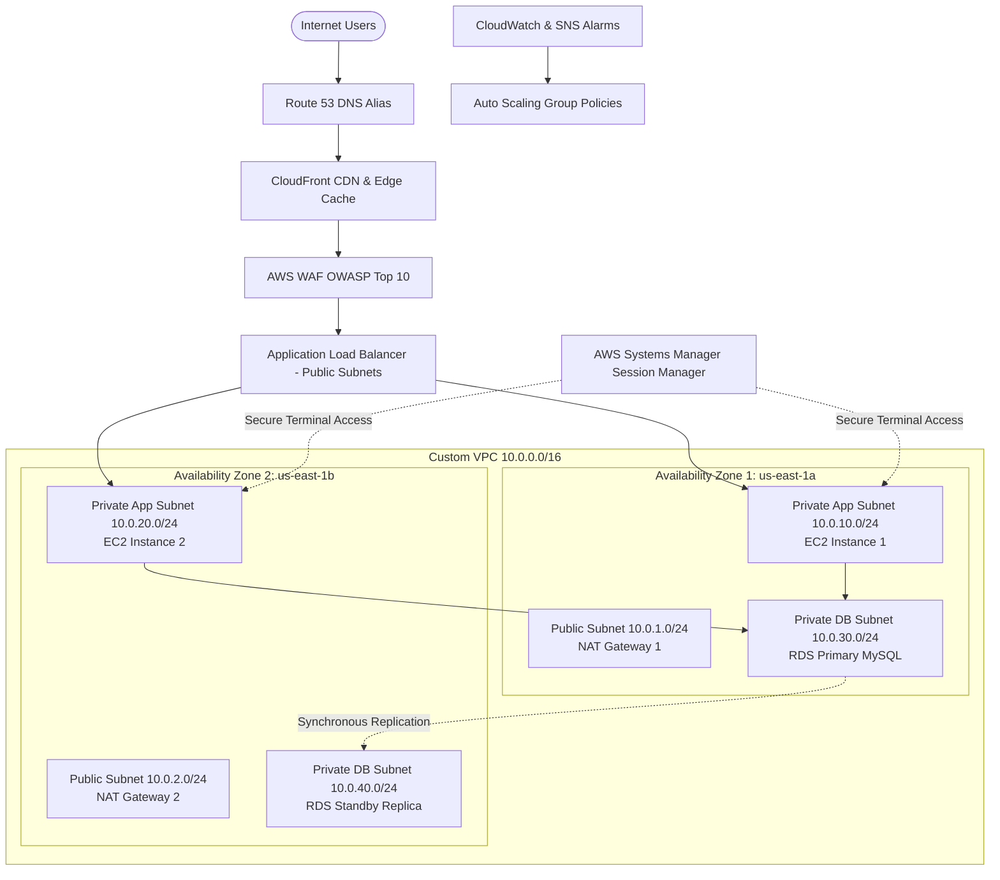

# Project 1: Scalable Web Application with ALB and Auto Scaling

## 📋 Project Summary
- **Architecture:** EC2-Based High Availability & Fault Tolerant Web App
- **Author:** AWS Solutions Architect Associate Candidate
- **Course Supervisor:** Eng. Ayman Aly Mahmoud (ayman@manara.tech)

---

## 🏗 Architecture Diagram


*Editable Draw.io diagram file is located at `architecture/architecture-diagram.drawio`.*

---

## ⚙️ Key AWS Services & Rationale
1. **Custom VPC with 6 Subnets across 2 AZs:** Provides strict network tiering (Public Web, Private App, Private Database).
2. **Application Load Balancer (ALB):** Performs Layer 7 health checks, SSL termination, and distributes incoming load evenly.
3. **Auto Scaling Group (ASG):** Maintains minimum 2 instances for high availability and scales up to 4 instances under peak CPU load.
4. **Amazon RDS Multi-AZ (MySQL 8.0):** Provides zero-data-loss failover in under 60 seconds if the primary database AZ experiences an outage.
5. **AWS Systems Manager (SSM) Session Manager:** Completely eliminates the need for Bastion Hosts or open SSH port 22, reducing attack surface to zero.
6. **AWS WAF + CloudFront:** Blocks SQL Injection, Cross-Site Scripting (XSS), and mitigates DDoS attacks at the AWS edge before touching the origin.

---

## 🚀 Step-by-Step Deployment Guide

### Option A: Automated Deployment via Terraform
1. Clone this repository:
   ```bash
   git clone <repo-url>
   cd 01-scalable-web-app-alb-asg/terraform
   ```
2. Initialize Terraform and review execution plan:
   ```bash
   terraform init
   terraform plan
   ```
3. Deploy all AWS resources:
   ```bash
   terraform apply -auto-approve
   ```
4. Access the web app using the output `cloudfront_domain_name` or `alb_dns_name`.

### Option B: Step-by-Step AWS Console Steps
1. **VPC Creation:**
   - VPC CIDR: `10.0.0.0/16`.
   - Subnets: 2 Public (`10.0.1.0/24`, `10.0.2.0/24`), 2 Private App (`10.0.10.0/24`, `10.0.20.0/24`), 2 Private DB (`10.0.30.0/24`, `10.0.40.0/24`).
   - Create Internet Gateway and attach to VPC. Attach Route Table to Public Subnets.
   - Deploy 1 NAT Gateway in Public Subnet 1 and update Private Route Table default route `0.0.0.0/0` -> NAT Gateway.
2. **Security Groups Configuration:**
   - `ALB-SG`: Inbound HTTP (80) & HTTPS (443) from `0.0.0.0/0`.
   - `App-SG`: Inbound HTTP (80) only from `ALB-SG`. Outbound `0.0.0.0/0`.
   - `DB-SG`: Inbound MySQL (3306) only from `App-SG`.
3. **Database Layer:**
   - Create DB Subnet Group including Private DB Subnet 1 and 2.
   - Launch RDS MySQL 8.0 with Multi-AZ deployment enabled, `db.t3.micro`, allocated storage 20GB.
4. **Compute Layer (Launch Template & ASG):**
   - Create IAM Role with policy `AmazonSSMManagedInstanceCore`.
   - Create Launch Template using Amazon Linux 2023 with `user-data.sh` script.
   - Create Auto Scaling Group: VPC Subnets = Private App Subnets, Min: 2, Desired: 2, Max: 4. Target Group = ALB Target Group.
5. **ALB & CloudFront:**
   - Create Internet-facing ALB in Public Subnets.
   - Create CloudFront distribution with Origin pointing to ALB DNS.

---

## 🧪 Testing & Validation Runbook

### 1. High Availability / Auto-Healing Test
- Go to EC2 Console -> Select one running App instance -> Click **Instance State -> Terminate Instance**.
- **Observation:** ALB Target Group marks instance `Unhealthy`. Auto Scaling Group detects instance failure and launches a new replacement instance within 120 seconds. Application suffers zero downtime.

### 2. Multi-AZ Database Failover Test
- In RDS Console -> Select Database -> Click **Actions -> Reboot with Failover**.
- **Observation:** The standby replica in AZ2 is promoted to primary within 40 seconds. The web application reconnects seamlessly via the RDS endpoint CNAME.

### 3. WAF Security Protection Test
- Access the web application URL with a malicious SQL injection payload:
  `http://<alb-or-cf-domain>/?id=1%20OR%201=1`
- **Observation:** AWS WAF inspects query string and immediately returns `403 Forbidden`.

---

## 🧹 Clean-Up (Teardown)
To avoid unnecessary AWS costs, run:
```bash
cd terraform
terraform destroy -auto-approve
```
