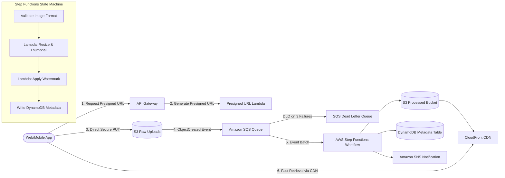

# Project 2: Serverless Image Processing Pipeline with S3, SQS & Lambda

## 📋 Project Summary
- **Architecture:** 100% Serverless Event-Driven Architecture (EDA)
- **Author:** AWS Solutions Architect Associate Candidate
- **Course Supervisor:** Eng. Ayman Aly Mahmoud (ayman@manara.tech)

---

## 🏗 Architecture Diagram


*Editable Draw.io diagram file is located at `architecture/architecture-diagram.drawio`.*

---

## ⚙️ Key AWS Services & Rationale
1. **Amazon S3 Presigned URLs via API Gateway:** Allows direct client-to-S3 uploads, completely bypassing servers and cutting bandwidth costs.
2. **SQS Queue & Dead Letter Queue (DLQ):** Decouples upload burst events from downstream processing, preventing Lambda throttling and guaranteeing zero lost files.
3. **AWS Step Functions:** Provides visual orchestration with automated retry logic and catch states across image conversion steps.
4. **AWS Lambda with Layers:** Runs Python image processing using Pillow in ephemeral, cost-efficient micro-compute instances.
5. **Amazon DynamoDB (On-Demand):** High-speed NoSQL store for image dimensions, file sizes, and processing timestamps.
6. **Amazon CloudFront:** Caches processed images globally, reducing origin egress costs and latency for end users.

---

## 🚀 Step-by-Step Deployment Guide

### Option A: Terraform Automated Deployment
```bash
cd 02-serverless-image-processing-pipeline/terraform
terraform init
terraform plan
terraform apply -auto-approve
```

### Option B: AWS Console Deployment Steps
1. Create two S3 buckets: `raw-images-<account-id>` and `processed-images-<account-id>`.
2. Create standard SQS queue `image-processing-queue` and configure a DLQ `image-processing-dlq`.
3. Configure S3 Event Notification on the raw bucket for `s3:ObjectCreated:*` targeting the SQS queue.
4. Deploy the AWS Lambda function with the Pillow Layer attached.
5. Build the Step Functions state machine linking the Lambda functions.
6. Create an Amazon DynamoDB table `ImageMetadata` with Partition Key `ImageId` (String).
7. Create a CloudFront Distribution pointing to the `processed-images` S3 bucket using Origin Access Control (OAC).

---

## 🧪 Testing & Validation Runbook

1. **Presigned URL Upload Test:**
   ```bash
   # Generate URL
   curl -X GET https://<api-id>.execute-api.us-east-1.amazonaws.com/prod/upload-url?filename=sample.jpg
   # Upload image directly
   curl -X PUT -T "sample.jpg" "<presigned-url>" -H "Content-Type: image/jpeg"
   ```
2. **Pipeline Execution Verification:**
   - Check AWS Step Functions Console -> View the active execution graph turning **Green**.
   - Check DynamoDB table -> Verify image metadata entry was recorded.
   - Check CloudFront URL -> Confirm thumbnail and watermarked image loads instantly in browser.
3. **Failure & DLQ Test:**
   - Upload an invalid or corrupted file (e.g. text file renamed as `.jpg`).
   - Step Function catches error -> Message sent to DLQ -> SNS sends email alert to admin.

---

## 🧹 Clean-Up (Teardown)
```bash
cd terraform
terraform destroy -auto-approve
```
