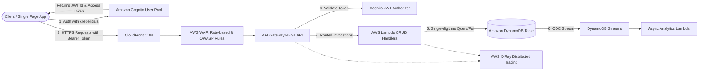

# Project 3: Serverless REST API with Cognito Auth, DynamoDB & WAF

## 📋 Project Summary
- **Architecture:** Enterprise Serverless Microservice API
- **Author:** AWS Solutions Architect Associate Candidate
- **Course Supervisor:** Eng. Ayman Aly Mahmoud (ayman@manara.tech)

---

## 🏗 Architecture Diagram


*Editable Draw.io diagram file is located at `architecture/architecture-diagram.drawio`.*

---

## ⚙️ Key AWS Services & Rationale
1. **Amazon Cognito User Pools:** Provides out-of-the-box user management, MFA, secure password policies, and JWT standard tokens.
2. **API Gateway with Cognito Authorizer:** Offloads authentication verification entirely from compute, ensuring unauthorized calls never hit Lambda.
3. **AWS WAF Rate Limiting:** Enforces maximum 2,000 requests per 5 minutes per IP to eliminate DDoS and brute-force attacks.
4. **Amazon DynamoDB (On-Demand & GSIs):** Serverless NoSQL offering high throughput, sub-10ms response times, and Global Secondary Indexes for flexible queries.
5. **DynamoDB Streams:** Captures Change Data Capture (CDC) events asynchronously for auditing and downstream indexing.
6. **AWS X-Ray:** Provides distributed tracing across API Gateway, Lambda, and DynamoDB to pinpoint latency bottlenecks.

---

## 🚀 Step-by-Step Deployment Guide

### Option A: Terraform Automated Deployment
```bash
cd 03-serverless-rest-api-cognito-dynamodb/terraform
terraform init
terraform plan
terraform apply -auto-approve
```

### Option B: AWS Console Deployment Steps
1. **Cognito Setup:** Create a User Pool `saa-p3-users`, configure password requirements, and create an App Client.
2. **DynamoDB Setup:** Create table `CustomerRecords` with Partition Key `userId` and Sort Key `recordId`. Enable DynamoDB Streams (New and Old Images).
3. **Lambda Creation:** Deploy `crud_handler.py` with IAM permissions to DynamoDB and X-Ray.
4. **API Gateway Setup:**
   - Create REST API `CustomerAPI`.
   - Add Cognito User Pool Authorizer.
   - Create resource `/records` with `GET`, `POST`, `PUT`, `DELETE` methods linked to Lambda.
   - Enable API Gateway Cache on `/records` GET.
5. **AWS WAF Association:** Create a Web ACL with rate-based rule (limit 2000) and AWSManagedRulesCommonRuleSet. Attach to API Gateway stage.

---

## 🧪 Testing & Validation Runbook

1. **Sign Up & Authenticate:**
   ```bash
   aws cognito-idp sign-up --client-id <CLIENT_ID> --username testuser@example.com --password "P@ssw0rd123!"
   # Retrieve ID Token
   TOKEN=$(aws cognito-idp initiate-auth --client-id <CLIENT_ID> --auth-flow USER_PASSWORD_AUTH --auth-parameters USERNAME=testuser@example.com,PASSWORD="P@ssw0rd123!" --query "AuthenticationResult.IdToken" --output text)
   ```
2. **Perform Authenticated CRUD Request:**
   ```bash
   # Create Record
   curl -X POST https://<api-id>.execute-api.us-east-1.amazonaws.com/prod/records \
        -H "Authorization: Bearer $TOKEN" \
        -H "Content-Type: application/json" \
        -d '{"title": "First Record", "content": "AWS Solutions Architect graduation project"}'
   ```
3. **Verify X-Ray Distributed Trace:**
   - Go to AWS X-Ray Console -> Service Map -> Inspect latency across Client -> API Gateway -> Lambda -> DynamoDB.

---

## 🧹 Clean-Up (Teardown)
```bash
cd terraform
terraform destroy -auto-approve
```
