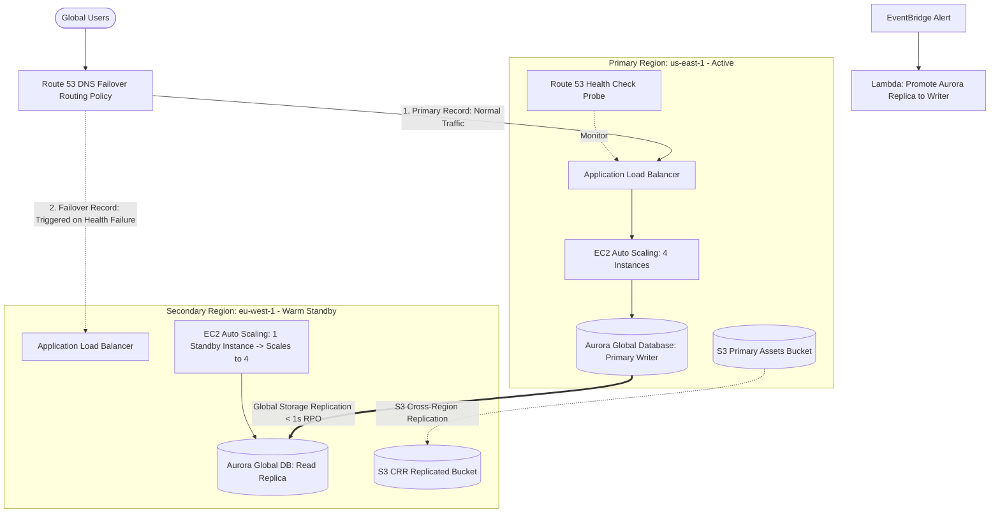

# Project 5: Multi-Region Disaster Recovery with Route 53 Failover

## 📋 Project Summary
- **Architecture:** Warm Standby Multi-Region Disaster Recovery (RTO < 5 mins, RPO < 1 sec)
- **Author:** AWS Solutions Architect Associate Candidate
- **Course Supervisor:** Eng. Ayman Aly Mahmoud (ayman@manara.tech)

---

## 🏗 Architecture Diagram


*Editable Draw.io diagram file is located at `architecture/architecture-diagram.drawio`.*

---

## ⚙️ Disaster Recovery Strategy Comparison
| Strategy | Description | RTO (Recovery Time) | RPO (Data Loss) | Cost |
| :--- | :--- | :--- | :--- | :--- |
| **Backup & Restore** | Daily snapshots restored upon disaster | 24 - 48 Hours | 24 Hours | $ (Lowest) |
| **Pilot Light** | Core database replicated, compute offline | 10 - 30 Minutes | Minutes | $$ (Low) |
| **Warm Standby (Implemented)** | Minimal compute running, scales up instantly, real-time DB replication | **< 5 Minutes** | **< 1 Second** | **$$$ (Moderate)** |
| **Multi-Site Active-Active** | Full capacity handling live traffic simultaneously in both regions | Real-time (0 sec) | 0 seconds | $$$$ (Highest) |

---

## 🚀 Step-by-Step Deployment Guide

### Option A: Terraform Deployment
```bash
cd 05-multi-region-dr-route53-failover/terraform
terraform init
terraform plan
terraform apply -auto-approve
```

### Option B: AWS Console Deployment Steps
1. **Primary Region (us-east-1):**
   - Deploy VPC, ALB, and Auto Scaling Group (Desired: 2 instances).
   - Launch Amazon Aurora MySQL cluster. Enable Aurora Global Database.
2. **Secondary Region (eu-west-1):**
   - Add region to Aurora Global Database to create cross-region read replica.
   - Deploy identical VPC and ALB with Auto Scaling Group (Desired: 1 instance - warm standby).
3. **Route 53 Failover Configuration:**
   - Configure Route 53 Health Check pointing to Primary ALB endpoint with 10-second interval.
   - Create Failover Record for `api.example.com`:
     - Primary Record -> Points to Primary ALB, Associated Health Check.
     - Secondary Record -> Points to Secondary ALB, Evaluate Target Health = Yes.
4. **S3 Cross-Region Replication:**
   - Enable Versioning on Primary and Secondary S3 buckets.
   - Create S3 Replication Rule replicating all objects from us-east-1 to eu-west-1.

---

## 🧪 Testing & Failover Simulation Runbook
1. **Normal State Verification:**
   - Query DNS: `dig api.example.com +short` -> Returns Primary ALB IP address.
2. **Simulate Disaster in Primary Region:**
   - Terminate all instances or drop the listener rule on Primary ALB.
   - Route 53 Health Check fails 3 consecutive checks (30 seconds).
   - Status changes from **Healthy** to **Unhealthy**.
3. **Failover Execution:**
   - Re-query DNS: `dig api.example.com +short` -> Route 53 instantly returns Secondary ALB IP address.
   - EventBridge triggers Lambda function to promote Aurora secondary replica into an independent standalone writer cluster.
   - Auto Scaling Group in eu-west-1 increases capacity from 1 to 4 instances.

---

## 🧹 Clean-Up (Teardown)
```bash
cd terraform
terraform destroy -auto-approve
```
