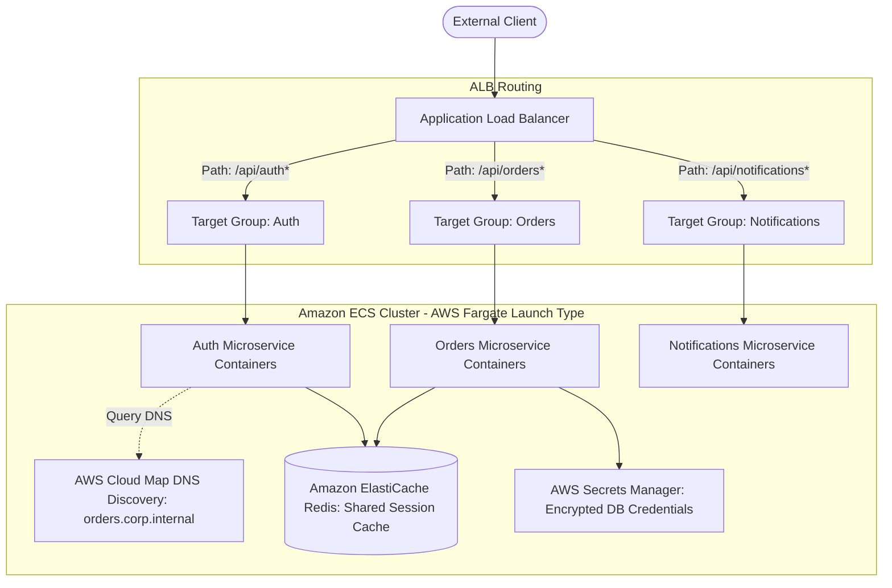

# Project 6: Containerized Microservices with ECS Fargate and Service Discovery

## 📋 Project Summary
- **Architecture:** Containerized Microservices on Serverless ECS Fargate
- **Author:** AWS Solutions Architect Associate Candidate
- **Course Supervisor:** Eng. Ayman Aly Mahmoud (ayman@manara.tech)

---

## 🏗 Architecture Diagram


*Editable Draw.io diagram file is located at `architecture/architecture-diagram.drawio`.*

---

## ⚙️ Key AWS Services & Rationale
1. **Amazon ECS on AWS Fargate:** Eliminates all server patching, OS maintenance, and capacity cluster planning; containers run in fully managed serverless microVMs.
2. **ALB Path-Based Routing:** Enables a single load balancer to route traffic cleanly to multiple microservices based on request URI (`/api/auth`, `/api/orders`, `/api/notifications`).
3. **AWS Cloud Map:** Provides dynamic DNS service discovery without requiring internal load balancers, drastically reducing network cost and latency.
4. **AWS Secrets Manager:** Automatically injects database credentials and third-party API keys directly into container environment variables at runtime without hardcoding.
5. **Amazon ElastiCache (Redis):** Provides sub-millisecond in-memory session management so microservices remain completely stateless.
6. **CodeDeploy Blue/Green Deployments:** Safely shifts traffic from Blue to Green task sets, running automated test listeners with zero-downtime automatic rollback.

---

## 🚀 Step-by-Step Deployment Guide

### Option A: Terraform Deployment
```bash
cd 06-containerized-microservices-ecs-fargate/terraform
terraform init
terraform plan
terraform apply -auto-approve
```

### Option B: AWS Console Deployment Steps
1. Create Amazon ECR repositories: `auth-service`, `orders-service`, `notifications-service`.
2. Build and push Docker images using AWS CLI credentials:
   ```bash
   aws ecr get-login-password | docker login --username AWS --password-stdin <account_id>.dkr.ecr.<region>.amazonaws.com
   docker build -t auth-service ./src/services/auth
   docker tag auth-service:latest <account_id>.dkr.ecr.<region>.amazonaws.com/auth-service:latest
   docker push <account_id>.dkr.ecr.<region>.amazonaws.com/auth-service:latest
   ```
3. Create an ECS Cluster with AWS Fargate capacity providers.
4. Register ECS Task Definitions with AWS CloudWatch Logs and execution roles.
5. Create an ALB with 3 Target Groups and path-based listener rules.
6. Create ECS Services linked to AWS Cloud Map private DNS namespace.

---

## 🧪 Testing & Validation Runbook
1. **Path-Based Routing Verification:**
   ```bash
   curl http://<alb-dns>/api/auth/health
   # Returns: {"service": "auth-service", "status": "UP"}
   curl http://<alb-dns>/api/orders/health
   # Returns: {"service": "orders-service", "status": "UP"}
   ```
2. **Service Discovery Internal Test:**
   - Execute into the Auth container using `aws ecs execute-command`.
   - Run `curl http://orders.corp.internal:3000/orders/health` -> Successfully resolves via AWS Cloud Map.
3. **Blue/Green Deployment Test:**
   - Trigger a CodeDeploy release with a new task definition -> Watch traffic route 10% canary, then shift 100% upon passing health check.

---

## 🧹 Clean-Up (Teardown)
```bash
cd terraform
terraform destroy -auto-approve
```
