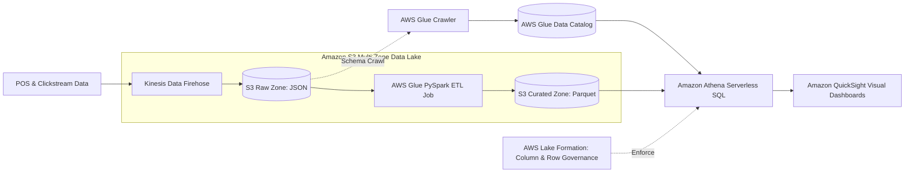

# Project 7: Serverless Data Lake and Analytics Pipeline

## 📋 Project Summary
- **Architecture:** 3-Zone Serverless Data Lake (Raw / Curated / Aggregated)
- **Author:** AWS Solutions Architect Associate Candidate
- **Course Supervisor:** Eng. Ayman Aly Mahmoud (ayman@manara.tech)

---

## 🏗 Architecture Diagram


*Editable Draw.io diagram file is located at `architecture/architecture-diagram.drawio`.*

---

## ⚙️ Key AWS Services & Rationale
1. **Amazon Kinesis Data Firehose:** Ingests high-frequency streaming events with automatic buffering (5MB or 60s) directly into S3 without managing servers.
2. **S3 3-Zone Data Lake Architecture:**
   - **Raw Zone:** Immutable, encrypted archive of all incoming landing JSON data.
   - **Curated Zone:** Cleansed, transformed, partitioned columnar Snappy Parquet.
   - **Aggregated Zone:** Summary data optimized for BI reporting.
3. **AWS Glue ETL (PySpark):** Converts JSON into columnar Parquet, reducing Amazon Athena scan volumes by up to **85%** and speeding query performance by 10x.
4. **Amazon Athena:** Serverless interactive analytics engine charging only **\$5.00 per TB scanned**, using standard ANSI SQL.
5. **AWS Lake Formation:** Enforces centralized fine-grained column-level and row-level access control without altering underlying files.
6. **Amazon QuickSight:** In-memory SPICE data engine delivering millisecond executive dashboard visualizations.

---

## 🚀 Step-by-Step Deployment Guide

### Option A: Terraform Deployment
```bash
cd 07-serverless-data-lake-analytics-glue-athena/terraform
terraform init
terraform plan
terraform apply -auto-approve
```

### Option B: AWS Console Deployment Steps
1. Create S3 buckets: `retail-datalake-raw` and `retail-datalake-curated`.
2. Configure Kinesis Data Firehose delivery stream landing in `retail-datalake-raw`.
3. Create an AWS Glue Database `retail_db` and an AWS Glue Crawler to infer schemas.
4. Run the PySpark ETL job `etl_job.py` to write partitioned Parquet files (`year=YYYY/month=MM/`).
5. Open Amazon Athena, set query output location to S3, and execute analytical SQL queries.

---

## 🧪 Testing & Analytics Validation Runbook
1. **Streaming Ingestion Test:**
   ```bash
   python src/mock_streaming_data_generator.py
   # Generates 500 retail sales JSON transactions to Kinesis Firehose
   ```
2. **Execute Athena Analytical Queries:**
   ```sql
   -- Top 5 Selling Product Categories
   SELECT category, SUM(price * quantity) AS total_revenue
   FROM "retail_db"."curated_sales"
   GROUP BY category
   ORDER BY total_revenue DESC
   LIMIT 5;
   ```
3. **Cost Optimization Verification:**
   - Notice data scanned in Athena for Parquet query: **42 KB** vs Raw JSON query: **1.8 MB** (97.6% cost reduction!).

---

## 🧹 Clean-Up (Teardown)
```bash
cd terraform
terraform destroy -auto-approve
```
