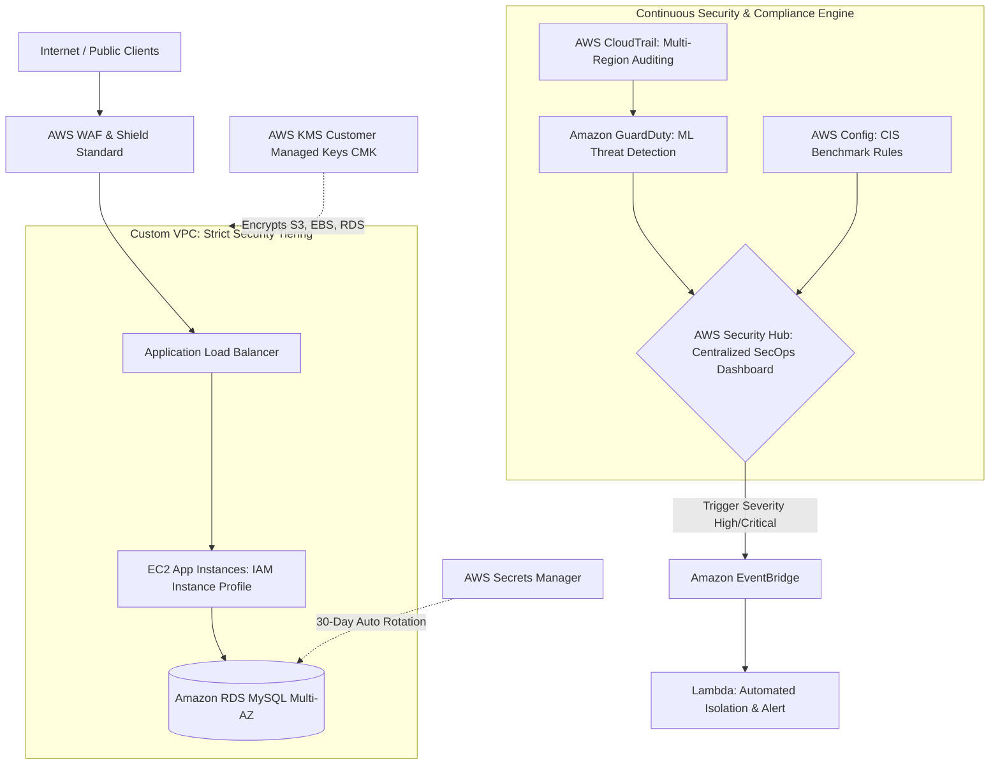

# Project 8: Secure Multi-Tier Architecture with GuardDuty, KMS & Security Hub

## 📋 Project Summary
- **Architecture:** Enterprise Defense-in-Depth Cloud Security Architecture
- **Author:** AWS Solutions Architect Associate Candidate
- **Course Supervisor:** Eng. Ayman Aly Mahmoud (ayman@manara.tech)

---

## 🏗 Architecture Diagram


*Editable Draw.io diagram file is located at `architecture/architecture-diagram.drawio`.*

---

## ⚙️ Key AWS Services & Rationale
1. **AWS KMS Customer Managed Keys (CMK):** Provides fine-grained key policies with automatic annual rotation, ensuring cryptographic control over EBS volumes, S3 buckets, and RDS databases.
2. **AWS Secrets Manager:** Automates credential rotation every 30 days via a managed Lambda function with zero downtime and strict audit logging.
3. **Amazon GuardDuty:** Employs machine learning, DNS log analysis, and threat intelligence feeds to discover unauthorized behavior (e.g. reconnaissance, crypto-mining, backdoors).
4. **AWS Security Hub:** Aggregates findings from GuardDuty, Config, and IAM Access Analyzer to produce a unified compliance score against **CIS AWS Foundations Benchmark v1.4.0**.
5. **AWS Config & Auto-Remediation:** Detects unencrypted volumes or public S3 buckets in real-time and triggers Systems Manager documents to remediate them automatically.
6. **Defense-in-Depth Alignment:** Maps 100% to the AWS Well-Architected Security Pillar and SAA-C03 Security domain.

---

## 🚀 Step-by-Step Deployment Guide

### Option A: Terraform Deployment
```bash
cd 08-secure-multi-tier-guardduty-kms-securityhub/terraform
terraform init
terraform plan
terraform apply -auto-approve
```

### Option B: AWS Console Deployment Steps
1. Create a Customer Managed Key (CMK) in AWS KMS with alias `alias/saa-p8-key`.
2. Enable Amazon GuardDuty across the region.
3. Enable AWS Security Hub with the CIS AWS Foundations Benchmark standard.
4. Configure AWS Config recording all resources and enable managed rule `s3-bucket-ssl-requests-only`.
5. Set up AWS Secrets Manager with secret rotation for the database credentials.
6. Deploy EventBridge Rule filtering for `GuardDuty Finding: High/Critical` routing to SNS and Lambda.

---

## 🧪 Security Validation & Threat Simulation Runbook
1. **Simulate Threat in GuardDuty:**
   - In GuardDuty Console -> Settings -> Click **Generate sample findings**.
   - Inspect findings such as `Recon:EC2/PortProbeUnprotectedPort` and `CryptoCurrency:EC2/BitcoinTool.B!DNS`.
2. **Security Hub Compliance Audit:**
   - Open AWS Security Hub -> Standards -> View compliance score percentage against CIS AWS Foundations Benchmark.
3. **Secrets Manager Rotation Verification:**
   - Go to Secrets Manager -> Select Secret -> Click **Rotate secret immediately**.
   - Confirm Lambda rotation function completes and new password version is active in RDS.

---

## 🧹 Clean-Up (Teardown)
```bash
cd terraform
terraform destroy -auto-approve
```
